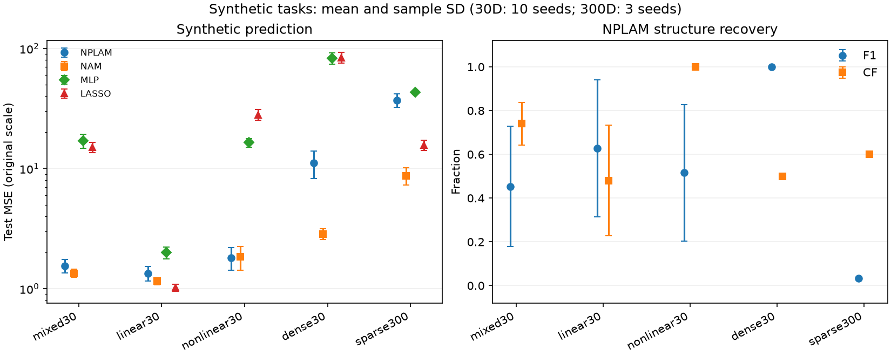

# NPLAM-Reproduction

神经部分线性加性模型（NPLAM）的独立 PyTorch 实现与实验。它同时预测一个数值，并尝试识别哪些输入变量无关、哪些近似线性、哪些需要非线性函数。

例如，给定只有输入和输出的样本，模型可以尝试从 `y = 3*x1 + sin(x2) + noise` 中找出 `x1` 的线性作用、`x2` 的非线性作用以及无关变量 `x3`。预测误差与结构识别准确性分开报告。

论文为 Zhu 等人的 [Neural partially linear additive model](https://doi.org/10.1007/s11704-023-2662-3)，*Frontiers of Computer Science*，18(6)，186334，2024。对照代码为作者的 [TensorFlow 实现](https://github.com/BestXuan/NPLAM/tree/73690d3ad9ae8687221775d37c3b4edc478f95a8)。

## 结果速览

本仓库记录了 **232 次评估**。在 30 维稀疏非线性任务中，模型识别出全部五个有效变量的非线性类型，但仍有较多误选。300 维稀疏任务的特征选择 F1 为 **0.033**。可在报告中分别查看预测误差、变量选择和结构识别的结果。



[完整结果](docs/experiment_report.md) · [逐种子数据与图](evidence/2026-11-11) · [两平台测试](https://github.com/12313Q2312/NPLAM/actions/runs/42971748551)

## 快速运行

建议用 Python 3.11，在仓库目录创建虚拟环境。Windows PowerShell 可以直接调用虚拟环境中的 Python。

```powershell
py -3.11 -m venv .venv
.venv\Scripts\python.exe -m pip install torch==2.6.0 --index-url https://download.pytorch.org/whl/cpu
.venv\Scripts\python.exe -m pip install -r requirements-ci.txt
.venv\Scripts\python.exe -m pip install --no-deps -e .
.venv\Scripts\python.exe -m pytest -q
.venv\Scripts\python.exe -m nplam.cli run --config configs/smoke.yaml --output runs/smoke
```

Linux 或 macOS 可将环境中的解释器路径换成 `.venv/bin/python`。其中的固定 CPU wheel 安装命令面向 CI 验证配置，即 Windows 和 Linux。冒烟实验生成合成数据，随后可以打开 `runs/smoke/REPORT.md` 和 `runs/smoke/mixed30-seed0/nplam/contributions.png`。再次运行时使用新的输出目录。

## 仓库内容

| 内容 | 入口 |
| --- | --- |
| 双门控、损失函数、变量作用曲线 | [数学模型](docs/mathematical_model.md) |
| 原文与旧实现差异 | [实现审计](docs/implementation_audit.md) |
| 实验配置、数据和运行命令 | [复现协议](docs/reproduction_protocol.md) |
| 完成的实验、结果与局限 | [实验报告](docs/experiment_report.md) |
| 论文实验覆盖范围与数据边界 | [局限说明](docs/limitations.md) |
| 单元、集成测试与两平台 CI | [tests](tests) · [workflow](.github/workflows/ci.yml) |

本项目的范围是独立实现、方法审计和有界复现实验。论文的完整参数搜索、基线集合和全部真实数据设置仍待复验。原始数据与训练权重留在本地运行目录。作者源码的许可核验见实现审计。

可以先查看一张贡献曲线，预测提高 `lambda2` 后哪些非线性分支会被压小。复制冒烟配置，改动该参数，再比较门控曲线、特征识别和测试误差，检查自己的预测。
