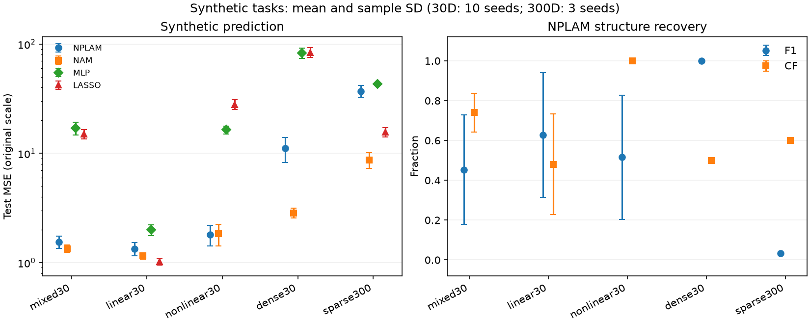
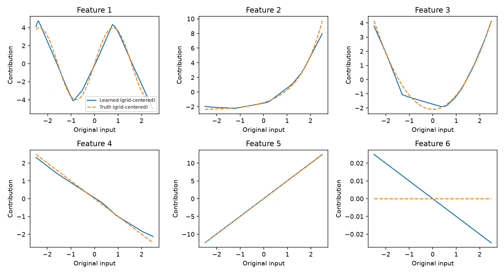

# NPLAM 独立实现实验报告

本轮评估了模型的预测误差和门控识别效果。30 维任务中，NPLAM 在非线性任务预测较好，但混合任务与稠密任务的平均预测误差高于简化 NAM。门控在若干任务中仍保留了很多无关变量。

## 合成数据

表内是测试集原尺度 MSE 的种子均值，越低越好。每个 30 维任务 10 个种子，300 维任务 3 个种子。F1 衡量有效变量的选择，CF 衡量真实有效变量中被正确判成线性或非线性的比例。

| 任务 | NPLAM MSE | NAM MSE | MLP MSE | Lasso MSE | NPLAM F1 | NPLAM CF |
| --- | ---: | ---: | ---: | ---: | ---: | ---: |
| 30 维稀疏混合 | 1.553 | 1.345 | 16.984 | 15.042 | 0.453 | 0.740 |
| 30 维稀疏线性 | 1.343 | 1.153 | 1.996 | 1.023 | 0.628 | 0.480 |
| 30 维稀疏非线性 | 1.812 | 1.835 | 16.432 | 28.070 | 0.516 | 1.000 |
| 30 维稠密混合 | 11.103 | 2.856 | 82.730 | 83.862 | 1.000 | 0.500 |
| 300 维稀疏混合 | 37.139 | 8.709 | 43.034 | 15.632 | 0.033 | 0.600 |

稀疏非线性任务中，NPLAM 正确识别全部五个有效变量的非线性结构，但 F1 只有 0.516，说明假阳性仍然明显。它与 NAM 的平均 MSE 只差约 0.023，本轮未据此作显著性结论。稠密任务的 F1=1 只表示全部变量入选，CF=0.5 表明仍有一半的有效变量类型判错。

300 维是本轮最明显的失败案例。NPLAM 的 MSE 为 37.14 ± 4.88，295 个无关变量中平均误选 294.33 个。Lasso 的 F1 为 0.75，NAM 的预测 MSE 最低。本轮设置下的正则强度、训练预算与门控阈值未能复现论文的高维结构识别表现。

图中前五个变量包含三个非线性和两个线性作用，第六个变量无关。各小图纵轴独立缩放。第六个变量的曲线振幅远小于有效变量，但门控是否选择该变量仍由同一个固定阈值决定。

## 消融实验

混合任务的固定正则配置下，8 种设置各跑 3 个种子。所有设置平均 F1 都为 0.286，平均 CF 都为 0.600，每次都选入了 25 个无关变量。基准 NPLAM 的平均 MSE 为 1.541，解冻隐藏参数后为 1.458，旧实现语义对照为 1.767。去掉门控惩罚或固定门的各组没有改善结构识别。该结果反映当前固定参数和阈值下的行为。

## 真实数据

每个模型在每个数据集运行 3 次。表内是测试集 R² 的种子均值，越高越好。

| 任务 | NPLAM | NAM | MLP | Lasso |
| --- | ---: | ---: | ---: | ---: |
| California Housing | 0.6940 | 0.7042 | 0.7448 | 0.6400 |
| Superconductivity | 0.7541 | 0.7990 | 0.8307 | 0.7278 |
| Beijing Air Quality | 0.8906 | 0.8913 | 0.9130 | 0.9038 |

这三项有界评估中，MLP 的平均 R² 最高。对解释性与预测的取舍，需要结合对照参数量、样本和数据划分一起读。北京结果衡量同一时刻的 PM2.5 回归。California 的原尺度 MSE 使用美元平方，不能与以十万美元作为目标尺度的表格直接相比。

超导种子 12 中，Lasso 选中的 `alpha=0.0001` 在 20,000 次迭代内未达到收敛容差。用相同训练集和容差把迭代上限提高至 200,000 次，仍有收敛警告，测试 MSE 为 339.8664，与主实验的 339.87 在报告精度下相同。主表保留原预算结果。

## 运行记录

九个任务共完成 232 次模型、数据和种子组合的评估，其中 160 次来自 30 维主实验，12 次来自 300 维实验，24 次来自消融，36 次来自真实数据。证据导出从每次保存的预测重新计算 MSE，并核对了配置中的运行组合。

实验在 Windows 11 CPU 上运行，Python 3.14.2、PyTorch 2.14.1+cpu，每个训练进程使用一个 Torch 线程。环境与包版本见各任务清单。30 维实验从先前运行复用 46 条结果，逐条核对配置、方法哈希、依赖、数据指纹与预测 MSE。原运行源码提交为 `405aa9c74705408f9d0304cec6b0a20899d253fa`，补齐任务时为 `8e0da9bf85debe0f5eaa70b064be8088ffbd7e75`。后续的汇总代码变动只影响结果分组和展示。

批量命令为 `python scripts/benchmark.py runs/full-20261111 --reuse-root runs/benchmark --workers 4`。原始运行目录保存每个 checkpoint、划分、预处理、预测和标准输出。[命令清单](../evidence/2026-11-11/jobs.json)

公开命令清单以 `python` 代替原解释器绝对路径。每次运行的参数、来源提交和环境版本均保留，完整原始日志保存在本地运行目录。

逐种子结果、标准差、模型参数量、门控轨迹和其它图见 [证据目录](../evidence/2026-11-11)。研究范围与论文实验的差异见 [局限说明](limitations.md)。
