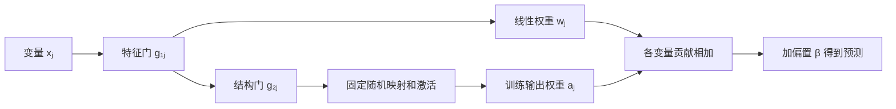

# 双门控模型

令样本有 \(d\) 个特征，每个特征的非线性分支有 \(h\) 个隐藏单元。下面的公式使用训练集缩放后的输入和目标。

$$
\hat y(x)=\beta+\sum_{j=1}^{d}\left[
w_jg_{1j}x_j+
\sum_{k=1}^{h}a_{jk}\,\phi(v_{jk}g_{1j}g_{2j}x_j+b_{jk})
\right].
$$

- \(g_{1j}\) 是特征选择门，影响两条分支。为零时，该变量的贡献与输入无关，可能剩下常数。
- \(g_{2j}\) 是结构发现门，只缩放非线性分支的输入。为零时，非线性分支变成常数，仍有斜率 \(w_jg_{1j}\) 的线性项。
- \(v,b\) 从标准正态分布初始化后冻结。训练更新 \(g_1,g_2,w,A,\beta\)。门是实数，允许负值。
- `paper` 模式采用 ReLU，`legacy` 模式采用负半轴斜率为 0.2 的 Leaky ReLU。

训练目标是缩放空间中的均方误差与三项 L1 惩罚之和。

$$
\mathcal L = \frac1n\sum_i(\hat y_i-y_i)^2+
\lambda_1\sum_j|g_{1j}|+\lambda_2\sum_j|g_{2j}|+
\lambda_3\sum_{j,k}|a_{jk}|.
$$

`legacy` 模式把三个求和分别改成均值。同一数值的正则系数在两种模式下对应不同强度。等价换算和 `Dense_sd` 的行为见 [实现审计](implementation_audit.md)。

## 如何读出结构

实验使用固定阈值 \(t_1=t_2=0.05\)。当 \(|g_1|\le t_1\) 时标记为无关；其余变量在 \(|g_1g_2|\le t_2\) 时标记为线性，否则标记为非线性。这个读法测量门控的选择效果。即使非线性门保留，输出权重和激活区间也可能让实际曲线接近直线。

预测可以相当准确，但门控识别仍可能较弱。线性系数只由乘积 \(g_1w\) 决定，存在尺度不唯一。贡献图把单变量作用曲线在绘图网格上中心化，并换回目标的原始单位。图用于读模型的函数形状，不能当作变量的因果效应。

## 实现对应

- `NPLAM.contributions` 返回每个样本的 \(d\) 个变量贡献，`forward` 求和并加偏置。
- `regularization` 计算三项惩罚，`structure` 应用阈值。
- `effective_linear_weights` 返回前向计算使用的 \(g_1w\)。
- `model.pt` 保存模型状态，包括冻结的随机映射。预测时使用同一运行目录的 `preprocessing.json` 还原输入和输出尺度。

公式依据 [论文第 3 节](https://doi.org/10.1007/s11704-023-2662-3)。
